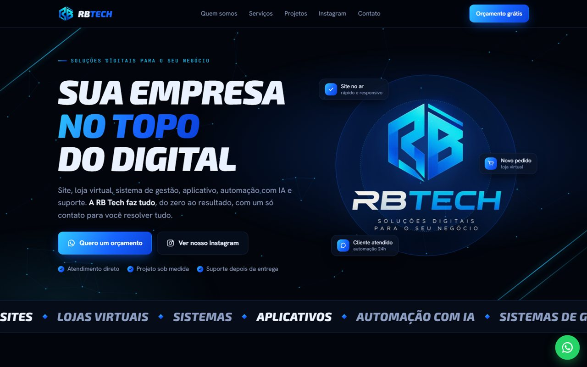
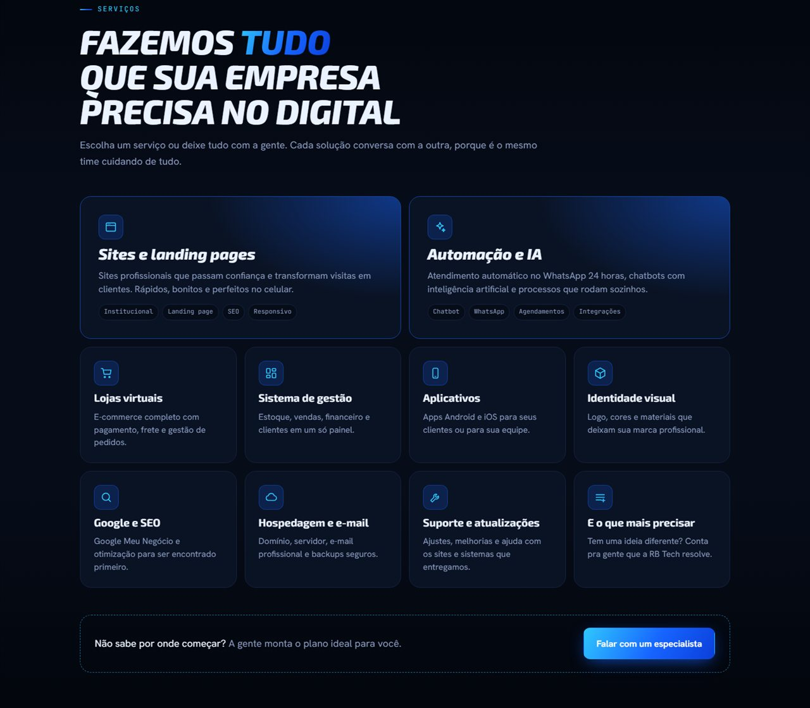
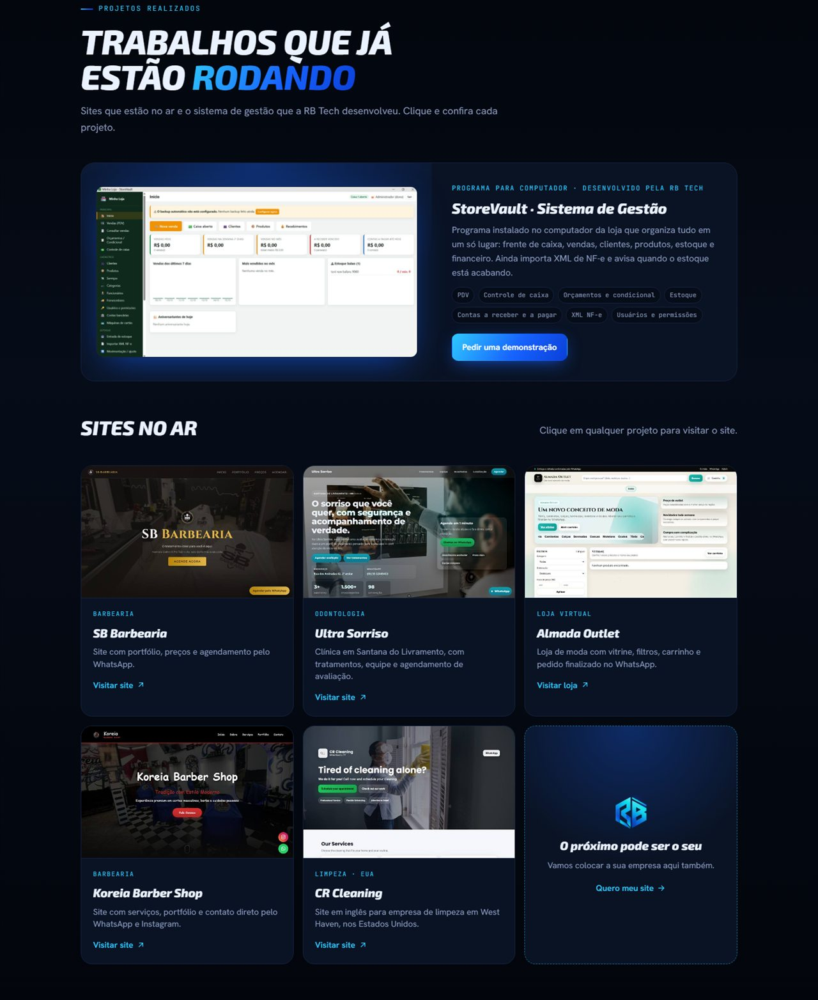

<div align="center">

# RB Tech · Landing Page

**Site institucional da RB Tech, empresa de soluções digitais.**
Projeto de design e desenvolvimento front-end, feito do zero com HTML, CSS e JavaScript puros.


<br>



</div>

---

## Sobre o projeto

A RB Tech precisava de uma página que apresentasse a empresa, mostrasse todos os serviços e transformasse visitantes em pedidos de orçamento pelo WhatsApp. O resultado é uma landing page de uma só página, com identidade visual em preto e azul elétrico baseada no logo da marca.

A página foi pensada para vender. Ela começa com a proposta de valor, apresenta a empresa e os serviços, mostra projetos reais já entregues e termina com chamadas diretas para contato.

## Destaques técnicos

- **Sem frameworks nem dependências.** O site inteiro é um único `index.html`, com CSS e JavaScript escritos à mão. Carrega rápido e pode ser hospedado em qualquer lugar.
- **Animação em Canvas.** O fundo do topo é uma rede de pontos conectados, desenhada em `<canvas>` com `requestAnimationFrame`, que reage ao movimento do mouse.
- **Layout responsivo.** CSS Grid e Flexbox com `clamp()` para tipografia fluida, testado da largura de celular ao monitor grande, sem rolagem lateral.
- **Design system com variáveis CSS.** Cores, fontes e espaçamentos definidos como tokens em `:root` e reaproveitados em todo o projeto, incluindo `color-mix()` para variações de cor.
- **Micro-interações.** Efeito de luz que acompanha o cursor nos cards, logo que reage ao mouse, revelação suave das seções com `IntersectionObserver` e faixa animada de serviços.
- **Acessibilidade.** HTML semântico, textos alternativos nas imagens, foco visível no teclado e respeito à preferência `prefers-reduced-motion`, que desliga as animações para quem pede.
- **SEO e compartilhamento.** Meta tags Open Graph, dados estruturados `schema.org` em JSON-LD e `robots.txt` para indexação no Google.
- **Conversão.** Botões de WhatsApp com mensagem pronta, botão flutuante fixo, número com cópia em um clique e Instagram em destaque.

## Seções da página

| Seção | Objetivo |
| --- | --- |
| Topo | Proposta de valor, chamadas para orçamento e Instagram |
| Quem somos | Apresentação da empresa, missão e jeito de trabalhar |
| Serviços | Grade com todos os serviços oferecidos |
| Por que a RB Tech | Diferenciais da empresa |
| Como funciona | Processo de trabalho em quatro etapas |
| Projetos realizados | Sistema de gestão e sites de clientes, com links |
| Instagram | Destaque para o perfil onde a empresa publica os projetos |
| Contato | WhatsApp, telefone e Instagram |

<details>
<summary><strong>Ver mais telas</strong></summary>
<br>

**Serviços**



**Projetos realizados**



</details>

## Projetos apresentados no site

Trabalhos reais da RB Tech que aparecem na seção de portfólio:

| Projeto | Segmento | Link |
| --- | --- | --- |
| SB Barbearia | Barbearia | [sb-barbearia.netlify.app](https://sb-barbearia.netlify.app/) |
| Ultra Sorriso | Odontologia | [ultrasorriso.netlify.app](https://ultrasorriso.netlify.app/) |
| Almada Outlet | Loja virtual | [almada-outlet.onrender.com](https://almada-outlet.onrender.com/) |
| Koreia Barber Shop | Barbearia | [koreiabarbershop.netlify.app](https://koreiabarbershop.netlify.app/) |
| CR Cleaning | Limpeza (EUA) | [cr-cleaning.netlify.app](https://cr-cleaning.netlify.app/) |
| StoreVault | Sistema de gestão para desktop | PDV, caixa, estoque, financeiro e importação de XML de NF-e |

## Como rodar localmente

Não há instalação nem etapa de build. Basta abrir o `index.html` no navegador, ou servir a pasta com qualquer servidor estático:

```bash
npx http-server@14.1.1 -p 5178 .
```

Depois acesse `http://localhost:5178`.

## Estrutura

```
.
├── index.html   # o site completo (HTML, CSS, JS e imagens embutidas)
├── robots.txt   # regras de indexação para buscadores
└── docs/        # imagens usadas neste README
```

## Autor

**Lucas Reppetto** · fundador da RB Tech

Desenvolvo sites, landing pages, lojas virtuais e sistemas de gestão para pequenas e médias empresas.

[](https://www.instagram.com/tech.rb7/)
[%2099682--2565-25D366?style=flat-square&logo=whatsapp&logoColor=white)](https://wa.me/5555996822565)
[](https://github.com/lucasreppetto010-cpu)
